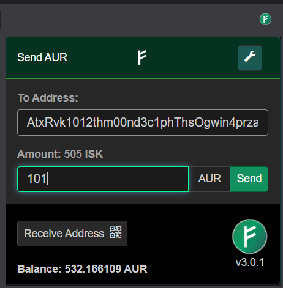

# Auroracoin Browser Wallet Extension 3.0.3 (testing)

### Provided by Auroracoin101 Project Team
Auroracoin wallet in your browser.  

### Extension Webstore(s) link
[Chrome Webstore for Auroracoin Browser Wallet](https://chromewebstore.google.com/detail/auroracoin-browser-wallet/ibbbddhliiimfdpadncmdnbhgagplagk)

## Releases
| Version    | Description |
|------------------ |------------ |
|  1.3.0 | Updated for Multi-Algo |
|  2.0.0 | Updated to use Insight exclusively for blockchain access and tx send |
|  2.0.1 | Removed incompatible API, exchange rates currently unavailable |
|  2.0.2 | Fixed API calls, exchange rates and currencies re-enabled |
|  2.0.3 | Internal Changes related to Github management |
|  2.0.4 | Removed BitCoinAverage API, using CryptoCompare |
|  2.0.5 | Removed Context Menu Features and Related Required Permissions |
|  2.0.6 | Various math fixes |
|  2.0.7 | Using TransactionBuilder now per bitcore warning. Now under Auroracoin101 github repository |
|  2.0.8 | Using chainz.cryptoid.info/aur as Blockchain Address Explorer |
|  2.0.9 | Updated Logo to 2020 version. Display Private Key/QR in 2 WIF formats |
|  2.1.0 | Moved Blockchain Interface to Electrum(x) SPV servers. Begin eCoinCore Integration |
|  2.1.1 | Improved Fallback |
|  2.1.2 | Added Electrum server @ electrum1.valhala.is |
|  2.1.3 | Insert OP_RETURN transaction support 
|  2.2.0 | Added Dark Mode, Fixed Currency Exchange, increased txfee to 0.0003 for large transactions (miners) |
|  3.0.0 | Upgraded to Google Manifest v3 |
|  3.0.1 | Removed tab requirement, not needed |
| 3.0.2 | Fixed Txxx Import issue |
| 3.0.3 | Sweep paper wallets (BIP38), wallet storage moved to local-only, dynamic fees, connection resilience *(in testing)* |

## Security

The private key is stored securely in your local browser storage and you may choose to encrypt it,
for added Security.

Transactions are signed in the browser and are published to Auroracoin Network via Electrum(x) Servers.

As of 3.0.3, the private key and other wallet data are kept in `chrome.storage.local` only — they are
not synced through your browser account and never leave your machine.

Encrypting the private key ensures that nobody will know the private key without the password, not even this extension.

## Technical Notes & Current Limitations

### Cryptography used
- **Wallet password encryption** uses AES (via CryptoJS). The password is never stored anywhere and is
  requested each time you send AUR or reveal your private key.
- **BIP38 paper wallet decryption** (Sweep Private Key) uses scrypt (scrypt-js) and AES (aes-js) — both
  MIT-licensed libraries bundled with the extension, with their license files included. Decryption runs
  entirely in your browser; the paper wallet password and unlocked key are held only in memory for the
  duration of the sweep and are never written to storage.
- **Transactions are signed locally** with bitcoinjs and broadcast to the Auroracoin network via
  Electrum(x) servers. Keys never touch a third-party web service.

### Current limitations (on the roadmap)
- **Single-address wallet** — one key pair, no BIP32/HD derivation or seed phrase yet.
- **No transaction history view** — balances only; use a block explorer link (provided after each send
  and sweep) to review transactions.
- **Sweep size cap** — a single sweep spends up to 400 inputs; if a key holds more payments than that,
  run the sweep again to collect the rest (the wallet tells you when this applies).
- **BIP38 unlocking takes a few seconds** — this is the scrypt algorithm doing its job (it is
  deliberately slow to resist brute-force). The progress is shown in the UI.
- **Exchange rates come from third-party APIs** and can occasionally be unavailable; sending and
  receiving AUR never depends on them.

